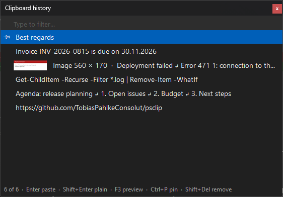
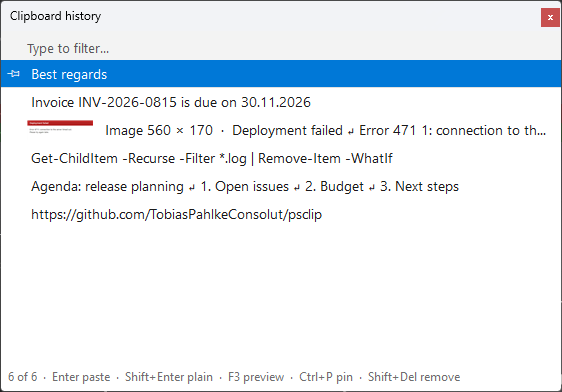
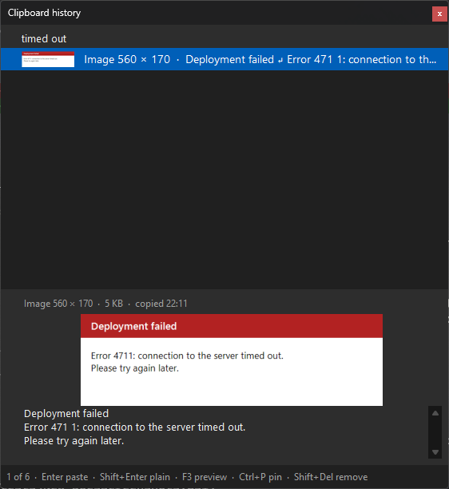
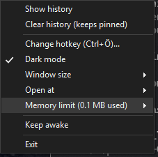

# psclip

A small clipboard history for Windows, inspired by [Ditto](https://ditto-cp.sourceforge.io/) but much simpler:
a PowerShell script, no extra software, no admin rights - and **nothing is ever written to disk**.
The history lives in memory only and is gone when the script exits.

<p>
  
  
</p>

## Features

- Records all text you copy, newest first (default: last 200 entries; copying an entry again moves it to the top)
- **Hotkey popup** (default `Ctrl+Ö` on a German keyboard) next to the mouse cursor: type to filter, `Enter` pastes
  into the window you were working in
- **Keeps the formatting** (HTML and RTF, e.g. from Word, Outlook or a browser): `Enter` pastes with formatting,
  `Shift+Enter` as plain text
- **Images** too, e.g. screenshots: shown with a thumbnail; the last 20 are kept
- **Search text in images**: the text in an image is recognized in the background (Windows' built-in OCR, offline),
  so typing a word from a screenshot finds it; typing `image` lists all images
- **Preview** (`F3`) of the selected entry below the list: the full text or the image
- **Pin** entries to the top - pinned entries are never dropped and survive "Clear history"
- **Dark mode** (default) or light mode, switchable from the tray menu
- **Three popup sizes** (S / M / L) - the popup always opens at the chosen size
- **Configurable hotkey** - as a parameter or at runtime from the tray menu
- Skips content that password managers mark as private
- **Keep awake** (optional, unrelated to the clipboard): presses the F15 key when you have been idle for 30 seconds,
  so Windows does not consider the session idle
- Tray icon with menu; one instance per Windows session

## Requirements

- Windows 10 or 11
- Windows PowerShell 5.1 (preinstalled on Windows)

## Install

In a PowerShell window:

```powershell
git clone https://github.com/TobiasPahlkeConsolut/psclip.git
cd psclip
.\Install.ps1 -Autostart
```

What `Install.ps1` does - and doesn't:

- It **does not copy anything**. psclip runs from the folder you cloned it to; keep that folder (or run
  `Install.ps1` again after moving it).
- It creates a **Clipboard Manager** shortcut in your Start menu
  (`%APPDATA%\Microsoft\Windows\Start Menu\Programs`), so you can start psclip like any app.
- With `-Autostart` it creates the same shortcut in your Startup folder (`shell:startup`), so psclip starts when you
  sign in. Without `-Autostart`, an existing autostart shortcut is removed.
- It starts psclip right away. If psclip is already running, it asks before restarting it (the history would be
  lost); `-Force` restarts without asking.
- Everything is per user: no admin rights (it refuses to run as administrator), no registry entries, no services.
- It needs Windows PowerShell 5.1 (`powershell.exe`), not PowerShell 7 (`pwsh`).

Settings are passed on to the shortcuts:

```powershell
.\Install.ps1 -Autostart -Hotkey 'Ctrl+Alt+V' -Theme Light -Size L -KeepAwake
```

Running `Install.ps1` again replaces the shortcuts, so this is also how you change settings permanently.

### Execution policy (only if needed)

With the common setting `RemoteSigned` (check with `Get-ExecutionPolicy -List`) the commands above work as they
are. Only if Windows refuses to run the scripts:

- **Downloaded as ZIP** instead of cloned: Windows marks the files as coming from the internet. Unblock them once:
  `Get-ChildItem -Recurse -Filter *.ps1 | Unblock-File`
- **Stricter policy** (`Restricted`, `AllSigned`): bypass it for this one call - it does not change your settings:
  `powershell -NoProfile -ExecutionPolicy Bypass -File .\Install.ps1 -Autostart`

The shortcuts start psclip with `-ExecutionPolicy Bypass` (for that process only), so autostart works with either
setting - unless the execution policy is enforced by Group Policy, which a command line cannot override.

## Run without installing

To try it out in a PowerShell window (`-Verbose` logs what happens, never the clipboard content itself; stop it with
*Exit* in the tray menu - `Ctrl+C` does not work while it runs):

```powershell
.\ClipboardManager.ps1 -Verbose
```

To run it without any window:

```powershell
conhost.exe --headless powershell.exe -NoProfile -File .\ClipboardManager.ps1
```

> Why `conhost.exe --headless`? With Windows Terminal as the default terminal (the default on Windows 11),
> `powershell -WindowStyle Hidden` leaves an empty terminal window open. `conhost --headless` runs the script
> without any window. The shortcuts created by `Install.ps1` use the same command.

## Usage

Press the hotkey anywhere. The popup opens at the mouse cursor:

| Key                            | Action                                           |
| ------------------------------ | ------------------------------------------------ |
| *type*                         | Filter - every word must match, case-insensitive; also searches the text in images |
| `Up` / `Down`, `PgUp` / `PgDn` | Move the selection                               |
| `Enter`, double-click          | Paste the entry into the window that was active, with its formatting |
| `Shift+Enter`                  | Paste it as plain text                           |
| `F3`                           | Show / hide the preview: full text or image, length, time copied |
| `Ctrl+P`                       | Pin / unpin the entry                            |
| `Shift+Delete`                 | Remove the entry                                 |
| `Esc`, click elsewhere         | Close                                            |

Words from a screenshot find it - here "timed out", with the preview (`F3`) showing the image and the recognized
text:



Right-click an entry for the same actions (*Paste as plain text* appears for entries with formatting). You can resize
the popup while it is open; the next time it opens at the chosen size again. The preview makes the popup taller and
stays on or off until psclip exits (`-Preview` to start with it).

The **tray icon** (a small blue clipboard, possibly in the `^` overflow area of the taskbar):



- left-click: open the history in *copy* mode - choosing an entry puts it on the clipboard without pasting
- right-click:
  - *Show history*
  - *Clear history (keeps pinned)*
  - *Change hotkey* - press the new combination
  - *Dark mode* - on / off
  - *Window size* - Small, Medium, Large
  - *Keep awake* - on / off (off by default)
  - *Exit*

Settings changed in the tray menu last until psclip exits (nothing is saved). To keep them, pass them to
`Install.ps1` (see [Options](#options)).

<br clear="right">

### Keep awake

Has nothing to do with the clipboard - it replaces a separate "mouse mover" tool. When switched on, psclip checks
every second how long there has been no mouse or keyboard input; after 30 seconds (`-KeepAwakeSeconds`) it presses
the **F15** key, which no keyboard has and no program uses (unlike Pause, which freezes the output of console
windows). Windows then never sees the session as idle. While you are working, nothing is sent.

## Options

| Parameter           | Default  | Description                                                                 |
| ------------------- | -------- | --------------------------------------------------------------------------- |
| `-Hotkey`           | `Ctrl+Ö` | Modifiers `Ctrl`, `Alt`, `Shift`, `Win` plus a key: a key name (`V`, `F12`, `Space`, `1`, ...) or the character on the key (`Ö`, `Ä`, `#`, ...) |
| `-Theme`            | `Dark`   | `Dark`, `Light` or `Auto` (follow the Windows app theme)                    |
| `-Size`             | `M`      | Popup size `S`, `M` or `L` - mostly the height (about 6, 10 or 17 entries visible) |
| `-MaxItems`         | `200`    | Unpinned entries to keep                                                    |
| `-MaxEntryLength`   | `1000000`| Texts with more characters are not recorded                                 |
| `-MaxImages`        | `20`     | Unpinned images to keep (they need much more memory than text); `0` = none  |
| `-Preview`          | off      | Start with the preview (`F3`) shown                                         |
| `-KeepAwake`        | off      | Start with *Keep awake* switched on                                         |
| `-KeepAwakeSeconds` | `30`     | Idle seconds before *Keep awake* presses F15                                |
| `-InstanceName`     | `PsClipboardManager` | Only to run a second, separate instance (the end-to-end test does)  |

Hotkeys that would get in the way of typing are refused: a plain key (only `F1`-`F11` and `F13`-`F24` work alone),
`Shift` plus a character key, and `Ctrl+Alt` plus a key that types a character with AltGr (e.g. `Ctrl+Alt+Q` = `@`
on a German keyboard).

The default hotkey is written as `Ctrl+Oemtilde` in the script (it must stay ASCII). It is the same physical key on
every layout: `Ctrl+Ö` on a German keyboard, ``Ctrl+` `` on a US keyboard (Ditto's default). On German keyboards VS
Code uses `Ctrl+Ö` to toggle its terminal; the global hotkey takes precedence, so pick another one if you need that.

`Get-Help .\ClipboardManager.ps1 -Full` shows the complete help.

## Uninstall

```powershell
.\Install.ps1 -Uninstall
```

This stops a running instance and removes both shortcuts. Then delete the folder.

## In Task Manager

psclip is a plain `powershell.exe` process: it is listed as **Windows PowerShell** under *Background processes*
(started via the shortcut, below a *Console Window Host* / `conhost.exe`). To tell it apart from other PowerShell
processes, open the *Details* tab, right-click a column header, *Select columns* and enable *Command line* - it shows
`...ClipboardManager.ps1`.

## Limitations

- **Text (with formatting) and images only.** Copied files are not recorded. When the clipboard holds both text and
  an image (e.g. Excel cells), psclip keeps the text. Texts longer than 1,000,000 characters (`-MaxEntryLength`) and
  images over 100 megapixels are skipped; formatting larger than the limit is dropped and the text kept.
- **Text recognition** uses the OCR languages installed in Windows for your profile languages (e.g. English). It
  works offline. Text in other languages is recognized less reliably (e.g. umlauts with English only); a German
  OCR language can be added in Windows' language settings (*Time & language > Language & region*) or by an
  administrator (`Add-WindowsCapability -Online -Name 'Language.OCR~~~de-DE~0.0.1.0'`). Without any OCR language,
  images are still recorded, just not searchable by their text.
- **In memory only** means psclip never writes the history anywhere. Windows itself may still move memory to the
  page file or into a crash dump, like for any program.
- **Windows running as administrator** do not accept the simulated `Ctrl+V` from a normal process. The entry is
  still put on the clipboard - press `Ctrl+V` yourself.
- **Combinations already taken** by another program cannot be captured in the *Change hotkey* dialog: nothing
  happens when you press them. Choose another one.
- Windows' own clipboard history (`Win+V`) is separate and unaffected.

## How it works

| File                   | Content                                                                      |
| ---------------------- | ---------------------------------------------------------------------------- |
| `ClipboardManager.ps1` | The app: clipboard history, popup, tray icon, hotkey, keep awake             |
| `PsClip.cs`            | C# helpers for Windows APIs PowerShell cannot call directly                  |
| `Install.ps1`          | Start menu / autostart shortcuts                                             |
| `tests/`               | Unit tests and the end-to-end test                                           |

At startup, `ClipboardManager.ps1` compiles `PsClip.cs` (`Add-Type`): a hidden window receives clipboard-change
notifications (`AddClipboardFormatListener`) and the global hotkey (`RegisterHotKey`). Each entry keeps the text plus
its HTML and RTF formatting in memory, images are kept PNG-compressed. Text in images is recognized with
`Windows.Media.Ocr`, called through WinRT from PowerShell, in the background. Pasting puts the entry back on the clipboard, brings the previous window to
the front and sends `Ctrl+V`. The popup, tray icon and dialogs are Windows Forms. Everything else is PowerShell.

## Development

See [AGENTS.md](AGENTS.md) for the conventions and pitfalls of this code base. There are two kinds of tests:

```powershell
# Unit tests: a few seconds, invisible (Pester 3.4, which ships with Windows)
.\tests\Invoke-UnitTests.ps1

# End-to-end test: starts its own psclip and drives it on the real desktop - it opens windows and sends keystrokes
# for about 45 seconds, so don't type, click or move the mouse meanwhile
.\tests\Test-ClipboardManager.ps1 -Theme Dark
.\tests\Test-ClipboardManager.ps1 -Theme Light
```

The end-to-end test runs a separate instance with its own name and hotkey and only ever closes that one, so a psclip
you are using keeps running - it just records the test's clipboard entries (they start with `psclip test:`).

`.\tests\New-DocsScreenshots.ps1` takes the screenshots in `docs\` the same way, with sample content.

## Internal use

© 2026 consolut. All rights reserved.

psclip is intended solely for internal use by consolut employees. It must not be distributed, published or made
available to third parties, in whole or in part. It is provided as is, without warranty of any kind and without
any obligation to provide support or updates.
