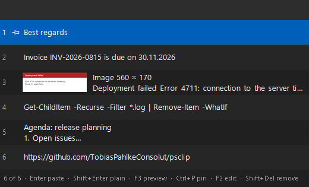
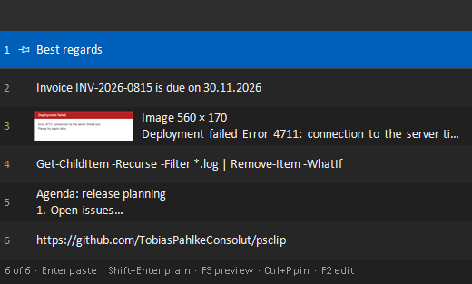
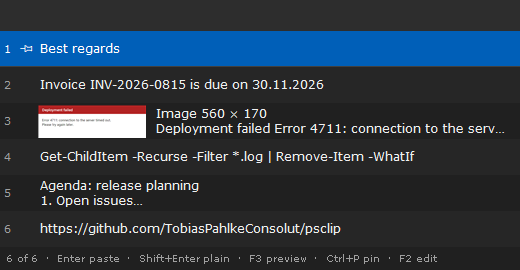
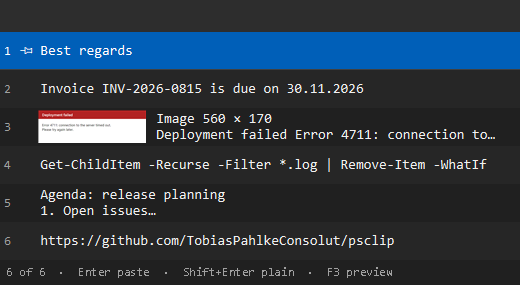
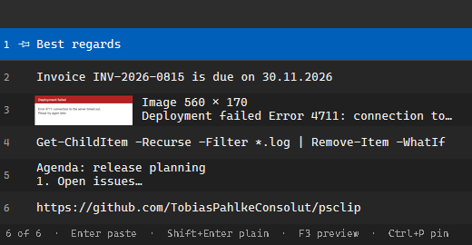
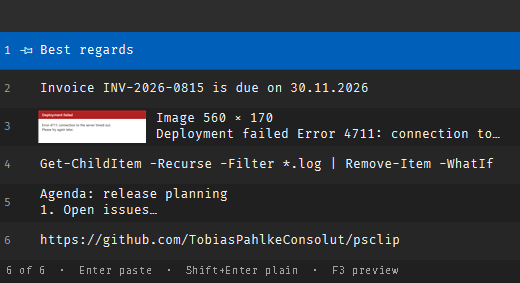

# Options

[Back to the README](../README.md)

psclip's settings live in **`settings.ini`** next to `ClipboardManager.ps1` (see [Settings file](#settings-file)):
`Install.ps1` writes it, the tray menu saves its changes to it, and you can edit it with any text editor. Each setting
is also a parameter of `ClipboardManager.ps1`, with the same name and values.

The defaults below are those of `ClipboardManager.ps1` started by itself. **`Install.ps1` uses three other
defaults** for a new `settings.ini`: `MaxMemory = 500MB`, `OpenAt = TextCursor` and `KeepPinned = true`
(`-KeepPinned:$false` switches it off).

| Setting / parameter | Default  | Description                                                                 |
| ------------------- | -------- | --------------------------------------------------------------------------- |
| `Hotkey`            | `Ctrl+Ö` | Modifiers `Ctrl`, `Alt`, `Shift`, `Win` plus a key: a key name (`V`, `F12`, `Space`, `1`, ...) or the character on the key (`Ö`, `Ä`, `#`, ...) |
| `Theme`             | `Dark`   | `Dark`, `Light` or `Auto` (follow the Windows app theme)                    |
| `Size`              | `M`      | Popup size `S`, `M` or `L`: 6, 10 or 15 entries (two lines each), as far as the screen allows |
| `Font`              | `Segoe UI` | Font of the popup's text - any installed font, sized so that its letters are as tall as Segoe UI's. The tray menu offers Segoe UI, Calibri, Verdana, Consolas, Cascadia Mono and Fira Code, those that are installed |
| `OpenAt`            | `Mouse`  | Where the hotkey opens the popup: `Mouse` (pointer) or `TextCursor`         |
| `MaxMemory`         | `100MB`  | Memory the history may use: `100MB`, `500MB` or `1GB` (pinned entries count, but are never dropped) |
| `KeepPinned`        | off      | *Keep pinned entries*: pinned entries survive restarts, encrypted (see [Keeping pinned entries](usage.md#keeping-pinned-entries)) |
| `Preview`           | off      | Open the popup with the preview (`F3`) shown                                |
| `KeepAwake`         | off      | *Keep awake* switched on                                                    |
| `KeepAwakeSeconds`  | `30`     | Idle seconds (1 to 3600) before *Keep awake* presses F15                    |
| `MaxEntryLength`    | `1000000`| Texts with more characters are not recorded                                 |
| `-InstanceName`     | `PsClipboardManager` | Parameter only: to run a second, separate instance (the end-to-end test does) |

## Settings file

`settings.ini` is a plain text file with one setting per line - the tray menu's *Edit settings file...* opens it in
Notepad (or whatever program opens `.ini` files on your PC):

```ini
# Size of the popup: S, M or L (6, 10 or 15 entries)
Size = M

# Where the hotkey opens the popup: Mouse (at the mouse pointer) or TextCursor (below the text cursor)
OpenAt = TextCursor

KeepAwake = true
```

- **Saved changes apply at once** - no restart needed (which would cost the history). A new hotkey that another
  program already uses is not taken; psclip keeps the old one and says so.
- **The tray menu saves its changes to the file** - only the line of that setting changes; your comments and the
  order stay.
- Lines starting with `#` or `;` are comments. Upper or lower case does not matter (`theme = light` works), and
  switches take `true`/`false`, `yes`/`no`, `on`/`off` or `1`/`0`.
- A setting that is missing gets its default (at the next start). A line psclip cannot use - a typo, a value that
  is not allowed - is ignored and reported at the tray icon with its line number.
- **It is optional**: without `settings.ini` (e.g. `ClipboardManager.ps1` started by itself), settings changed in the
  tray menu last until psclip exits, and nothing is written. *Edit settings file...* creates it with the current
  settings; from then on psclip keeps them. Delete it to go back.
- **Parameters given on the command line win** over the file at every start - useful for a test, but in a shortcut
  they would undo what you change in the tray menu, so the shortcuts of `Install.ps1` pass none. If psclip notices
  such a setting changing, it says so once.
- Hotkeys are written as key names that mean the same key on every keyboard layout: `Ctrl+Oemtilde` is `Ctrl+Ö` on a
  German keyboard and ``Ctrl+` `` on a US one. Writing the character on the key (`Ctrl+Ö`) works as well.
- It is saved as UTF-8, like the tray menu's changes: written to a temporary file first, then swapped in, so an
  interrupted write never leaves half a file. Another instance (`-InstanceName X`) uses `settings-X.ini`. Git ignores
  both.

## Fonts

*Font* in the tray menu (or `Font = ...` in `settings.ini`) changes the font of the popup's text. The same entries in
each font of the menu - Fira Code only if it is installed, it does not come with Windows:

| Segoe UI (default) | Calibri |
| --- | --- |
|  |  |
| **Verdana** | **Consolas** |
|  |  |
| **Cascadia Mono** | **Fira Code** |
|  |  |

Monospace fonts (Consolas, Cascadia Mono, Fira Code) suit code and IDs, but fit fewer characters into a row.

## Text size

There is no size setting: psclip follows Windows. The display scaling (*Settings > System > Display > Scale*) makes
everything bigger, and the text size (*Settings > Accessibility > Text size*) makes the text bigger - psclip applies
a change the next time the popup opens. Each font is sized so that its lowercase letters are as tall as Segoe UI's
at the same setting: at the same point size, fonts look quite different (Fira Code, for example, would look a good
deal bigger than Segoe UI).

## Hotkeys

Hotkeys that would get in the way of typing are refused: a plain key (only `F1`-`F11` and `F13`-`F24` work alone),
`Shift` plus a character key, and `Ctrl+Alt` plus a key that types a character with AltGr (e.g. `Ctrl+Alt+Q` = `@`
on a German keyboard).

The default hotkey is written as `Ctrl+Oemtilde` in the script (it must stay ASCII). It is the same physical key on
every layout: `Ctrl+Ö` on a German keyboard, ``Ctrl+` `` on a US keyboard. On German keyboards VS Code uses `Ctrl+Ö`
to toggle its terminal; the global hotkey takes precedence, so pick another one if you need that.

`Get-Help .\ClipboardManager.ps1 -Full` shows the complete help.
