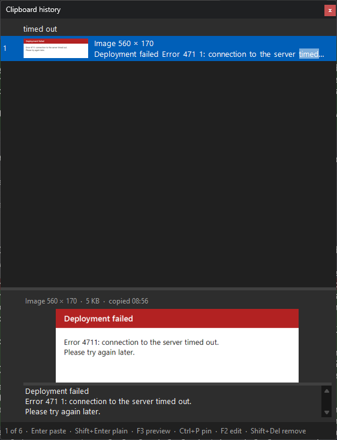
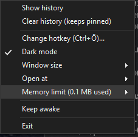

# Usage

[Back to the README](../README.md)

## The popup

Press the hotkey anywhere. The popup opens at the mouse pointer, or - with *Open at > Text cursor* in the tray menu
(`-OpenAt TextCursor`, the default of `Install.ps1`) - just below the text cursor of the window you are typing in:

| Key                            | Action                                           |
| ------------------------------ | ------------------------------------------------ |
| *type*                         | Filter - every word must match, case-insensitive; also searches the text in images |
| `Up` / `Down`, `PgUp` / `PgDn` | Move the selection                               |
| `Enter`, double-click          | Paste the entry into the window that was active, with its formatting |
| `Shift+Enter`                  | Paste it as plain text                           |
| `F3`                           | Show / hide the preview: full text or image, length, time copied |
| `F2`                           | Edit the text in a window of its own; `Esc` saves and closes it (changed text loses its formatting) |
| `Ctrl+P`                       | Pin / unpin the entry                            |
| `Shift+Delete`                 | Remove the entry                                 |
| `Alt+1` ... `Alt+9`, `Alt+0`   | Paste the entry with that number (the first ten rows are numbered); with `Shift` as plain text |
| `Esc`, click elsewhere         | Close                                            |

Every entry shows two lines: line breaks stay, long text wraps and ends with "..." where it is cut. Every second row
is slightly shaded, and the words you filter by are highlighted. Right-click an entry for the same actions (*Paste as
plain text* appears for entries with formatting). You can resize the popup while it is open; the next time it opens
at the chosen size again (`-Size`: 6, 10 or 15 entries).

## Text in images

Words from a screenshot find it - here "timed out", with the preview (`F3`) showing the image and the recognized
text:

The text in images is recognized in the background with Windows' built-in OCR, offline. Typing `image` lists all
images.

## Preview

The preview (`F3`) makes the popup taller. Drag the bar on its top edge to make it bigger, and the bar between an image
and its recognized text to give either more room. Click into the preview to select text and copy it (`Ctrl+C`,
`Ctrl+A` or right-click), e.g. a number from a screenshot; typing a character goes back to the filter. Every time the
popup opens, the preview is hidden again and has its default size (`-Preview` opens the popup with it).

## Editing

`F2` opens the selected text entry in a window of its own - a plain text box in the theme's colors, without buttons.
Closing it (`Esc` or its `X`) saves. If you changed the text, the entry becomes plain text (its HTML and RTF formatting
belonged to the old text); if not, it stays as it was. Images cannot be edited.

## The tray icon

The tray icon is a small blue clipboard, possibly in the `^` overflow area of the taskbar.

- left-click: open the history in *copy* mode - choosing an entry puts it on the clipboard without pasting
- right-click:
  - *Show history*
  - *Clear history (keeps pinned)*
  - *Change hotkey* - press the new combination
  - *Dark mode* - on / off
  - *Window size* - Small, Medium, Large
  - *Open at* - Mouse pointer, Text cursor
  - *Memory limit* - 100 MB, 500 MB, 1 GB; shows how much the history uses. A lower limit drops the oldest
    entries right away
  - *Keep pinned entries* - on / off: save the pinned entries for the next start (see
    [Keeping pinned entries](#keeping-pinned-entries))
  - *Keep awake* - on / off (off by default)
  - *Exit*

Settings changed in the tray menu last until psclip exits (nothing is saved). To keep them, pass them to
`Install.ps1` (see [Options](options.md)).

 

## Keep awake

Has nothing to do with the clipboard - it replaces a separate "mouse mover" tool. When switched on, psclip checks
every second how long there has been no mouse or keyboard input; after 30 seconds (`-KeepAwakeSeconds`) it presses
the **F15** key, which no keyboard has and no program uses (unlike Pause, which freezes the output of console
windows). Windows then never sees the session as idle. While you are working, nothing is sent.

## Keeping pinned entries

With *Keep pinned entries* on, pinned entries survive restarts; otherwise they are gone when psclip exits, like the
rest of the history. `Install.ps1` switches it on (`-KeepPinned`) unless you pass `-KeepPinned:$false`;
`ClipboardManager.ps1` started by itself has it off. The tray menu switches it, until psclip exits.

- The pinned entries are saved to **`pinned.dat` next to `ClipboardManager.ps1`** - texts with their formatting,
  images as PNG - every time they change (pin, unpin, remove, copying a pinned text again), and loaded at the next
  start. Not only at exit: a crash, a killed process or a power cut would skip that. Writing goes to a temporary file
  first, flushed to the disk, and then replaces the old version - an interrupted write leaves the old one intact.
  Nothing else of the history is ever saved.
- **Switching it on** saves the current pinned entries right away; entries an earlier run saved are added to them.
  **Switching it off** deletes `pinned.dat` right away. The pinned entries stay until psclip exits, so switching it on
  again saves them again. If psclip starts with it off while a `pinned.dat` exists, it says so.
- The file is **encrypted for your Windows account** (DPAPI, the protection Windows' Credential Manager and browsers
  use for saved passwords): the key comes from your Windows sign-in, so other users of the PC cannot read it, and
  neither can anyone else who copies the file to another computer. Programs running under your own account could
  decrypt it - like they could read psclip's memory.
- **A file psclip cannot read is never overwritten or deleted.** If it cannot be decrypted (another Windows account's
  or computer's file, a password an administrator reset, damage), psclip says so at startup and switches *Keep
  pinned entries* off; switching it on renames the file to `pinned.dat.unreadable-<date>` and starts a new one. If
  the file is only in use (e.g. by a backup program), the setting stays off until switching it on succeeds.
- The key belongs to one Windows account on one computer: if several users share the psclip folder, or it is synced
  to other computers (e.g. OneDrive), each of them can only read their own `pinned.dat` - use a folder of your own.
- Git ignores `pinned.dat` (`.gitignore`), so it never ends up in a commit.
